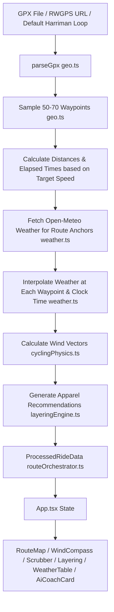

# VeloCast (Velocaster) - Codebase Architecture & Maintainer Guide

**VeloCast** is an intelligent cycling route weather forecast and tactical preparation web application. It takes a cycling route (GPX file or RideWithGPS route) and departure schedule, models rider progression along the route, interpolates micro-climate weather forecasts (wind, precipitation, temperature, feels-like), and produces:
- An interactive map with route waypoints, wind direction arrows, and weather badges
- An elevation profile with temperature and weather overlays
- Dynamic wind breakdown (headwind, tailwind, crosswind percentages and worst-sector analysis)
- An AI Directeur Sportif tactical coaching briefing (via Google Gemini AI or rule-based fallback)
- Granular layering and kit recommendations (gloves, vests, base layers, jackets)
- An interactive timeline scrubber and detailed waypoint weather table

---

## 1. Tech Stack & Key Libraries

- **Framework**: [React 19](https://react.dev/) + [TypeScript](https://www.typescriptlang.org/)
- **Build Tool**: [Vite 8](https://vitejs.dev/) with `@vitejs/plugin-react`
- **Styling**: [Tailwind CSS v4](https://tailwindcss.com/) with `@tailwindcss/vite`
- **Mapping**: [Leaflet](https://leafletjs.com/) with Carto basemaps
- **AI Integration**: `@google/genai` (Google Gemini 2.5 Flash SDK)
- **Icons**: `lucide-react`
- **Animations**: `motion`

---

## 2. Project Directory Structure

```text
velocaster/
├── .env.example              # Environment variables template
├── index.html                # Vite HTML entry point
├── package.json              # Project dependencies & npm scripts
├── tsconfig.json             # TypeScript configuration
├── vite.config.ts            # Vite build, plugins & env config
└── src/
    ├── main.tsx              # React DOM bootstrap
    ├── App.tsx               # Root application component & core state
    ├── index.css             # Tailwind & base styling
    ├── assets/
    │   └── Harriman_Loop.gpx # Default bundled route GPX file
    ├── data/
    │   └── defaultRoute.ts   # Exports DEFAULT_GPX_DATA and DEFAULT_GPX_NAME
    ├── types/
    │   └── cycling.ts        # TypeScript interfaces & domain types
    ├── components/
    │   ├── Header.tsx        # Top navigation header & branding
    │   ├── RideControls.tsx  # Date, start time, target speed, & unit selectors
    │   ├── RouteMap.tsx      # Leaflet map rendering route, markers & wind vectors
    │   ├── WindCompass.tsx   # Visual wind vector compass, headwind/tailwind gauges
    │   ├── RideTimelineScrubber.tsx # Time & distance slider controller
    │   ├── ElevationProfile.tsx     # Canvas/SVG elevation & weather profile
    │   ├── LayeringGuide.tsx # Kit recommendations (head, torso, legs, extremities)
    │   ├── WeatherTable.tsx  # Granular table of hourly waypoints along the ride
    │   ├── AiCoachCard.tsx   # 3-card tactical coaching briefing & AI generator
    │   └── GpxUploadModal.tsx# GPX upload, paste XML, or RideWithGPS importer
    └── utils/
        ├── geo.ts            # GPX parsing (DOMParser), Haversine, bearing, waypoint sampling
        ├── weather.ts        # Open-Meteo API fetching & linear weather interpolation
        ├── cyclingPhysics.ts # Headwind/tailwind/crosswind vectors & drag models
        ├── layeringEngine.ts # Logic engine for kit & apparel selection based on conditions
        ├── routeOrchestrator.ts # Orchestrates GPX -> Sampling -> Weather -> Physics -> Layering
        └── rwgps.ts          # RideWithGPS route fetching & conversion
```

---

## 3. Data Flow & Core Architecture



### Route Processing Steps:
1. **GPX Parsing (`src/utils/geo.ts`)**:
   - Uses browser `DOMParser` to parse GPX `<trkpt>` nodes with latitude, longitude, and elevation.
   - Computes cumulative distance using the Haversine formula and extracts route bounds and elevation gain/loss.

2. **Waypoint Sampling (`src/utils/geo.ts`)**:
   - Large GPX files (e.g. 10,000+ track points) are downsampled to ~50–60 representative waypoints evenly spaced by distance.
   - Computes bearing between consecutive waypoints for directional heading.

3. **Time & Progression Modeling (`src/utils/routeOrchestrator.ts`)**:
   - Given user departure time and average speed, computes the exact ETA at each waypoint along the route.

4. **Weather Fetching & Interpolation (`src/utils/weather.ts`)**:
   - Selects 3 to 6 geographic anchor points along the route and queries the [Open-Meteo API](https://open-meteo.com/) for hourly forecasts (temperature, apparent temperature, wind speed, wind direction, wind gusts, precipitation probability, weather codes).
   - Linearly interpolates weather values between nearest anchors and hourly timestamps to reflect the exact conditions the rider will encounter at that point and time.

5. **Wind Component Analysis (`src/utils/cyclingPhysics.ts`)**:
   - Compares the rider's travel bearing to the incoming wind direction.
   - Computes headwind, tailwind, and crosswind velocity components, calculating total percentages and identifying the worst headwind sector.

6. **Layering & Kit Advisor (`src/utils/layeringEngine.ts`)**:
   - Assesses minimum and maximum feels-like temperature, wind exposure, precipitation chance, and start temperature.
   - Suggests base layers, jerseys, jackets, vests, bibs, leg warmers, gloves, and shoe covers.

---

## 4. Components Overview

| Component | Responsibility |
| :--- | :--- |
| **`App.tsx`** | Top-level coordinator: maintains GPX XML, route name, speed, units (`imperial` / `metric`), active scrubber waypoint, and triggers `processRideRoute`. |
| **`Header.tsx`** | Application title, route name badge, reset route button, and GPX upload trigger. |
| **`RideControls.tsx`** | Controls for departure date, start time, target speed slider, and imperial/metric unit switcher. |
| **`RouteMap.tsx`** | Leaflet interactive map rendering route polylines, start/finish flags, weather badges, wind vector arrows, and synchronized active scrubber position. |
| **`WindCompass.tsx`** | Visual wind vector compass, headwind/tailwind/crosswind exposure meters, and worst headwind stretch callout. |
| **`RideTimelineScrubber.tsx`** | Interactive slider allowing scrubbing across the entire ride to inspect waypoint conditions at any distance or time. |
| **`ElevationProfile.tsx`** | Interactive canvas rendering elevation profile with color-coded grade and temperature trend line. |
| **`LayeringGuide.tsx`** | Visual checklist for kit and thermal management (Head/Neck, Upper Body, Lower Body, Extremities). |
| **`WeatherTable.tsx`** | Detailed tabular breakdown of every sampled waypoint (time, mile/km, temp, wind, precipitation). |
| **`AiCoachCard.tsx`** | Directeur Sportif tactical card displaying 3 styled cards: Aerodynamic Tactics, Pacing Strategy, and Hydration & Fueling. Connects to Gemini AI to generate customized route strategies. |
| **`GpxUploadModal.tsx`** | Modal offering 3 ways to import routes: RideWithGPS URL/ID, local `.gpx` file upload, or direct XML copy-paste. |

---

## 5. Development & Configuration

### Environment Variables
Configure in `.env.local` or `.env`:
- `GEMINI_API_KEY`: API key for Gemini AI tactical briefings.
- `VITE_CARTO_KEY` / `CARTO_KEY`: Carto basemap tile URL key for Leaflet map tiles.

### Scripts
- `npm run dev`: Starts Vite local development server on port 3000.
- `npm run build`: Type-checks with `tsc` and bundles production assets into `dist/`.
- `npm run preview`: Previews the production build locally.
- `npm run lint`: Runs TypeScript validation (`tsc --noEmit`).

---

## 6. Maintenance & Extension Tips

- **Adding / Changing Default Route**:
  Place the new GPX file in `src/assets/` and update `src/data/defaultRoute.ts` using Vite's `?raw` loader.
- **Modifying AI Coach Prompt or Parsing**:
  Adjust prompt formatting and regex card extraction in `src/components/AiCoachCard.tsx`.
- **Weather API Considerations**:
  Open-Meteo is free and does not require an API key, but requests are batched using geographic anchors in `routeOrchestrator.ts` to prevent rate limiting.
